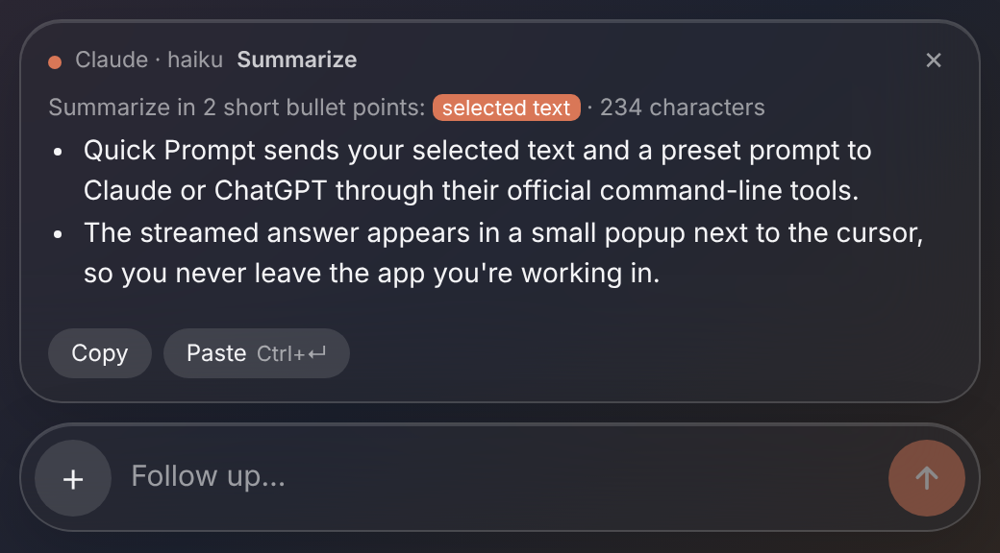

# Quick Prompt

Ask Claude or ChatGPT about the text you have selected, from your Logitech **Actions Ring**, without leaving the app you are working in.

Press a ring button and the selection, together with that button's prompt, is sent in the background to Claude or ChatGPT, either through their CLIs (**Claude Code** / **Codex**, using your existing subscription) or through their **APIs** with your own key (faster). The answer streams into a small popup next to the mouse cursor. On macOS the popup is a native Liquid Glass panel. The Claude and ChatGPT apps never open, and your current app stays in front.

## Features

- **Two actions:** *Ask Claude* and *Ask ChatGPT*. Add either one to the ring as many times as you like.
- **Each ring button is a preset**, with its own title, prompt, input source, behavior, icon, color and model, all set in the Options+ action editor.
- **Four behaviors:** send and show the answer in the popup, edit in the popup first, replace the selection (no popup), or copy to the clipboard (no popup).
- **Popup:** follow-up questions, **Copy**, and **Paste** (⌘↵ / Ctrl+Enter) into the app you came from.
- **Pin and move (macOS):** drag the popup by its top row or the empty part of the capsule and drop it anywhere; throw it and it glides to that corner of the screen. Pinned (📌), it stays above every app, and Esc / ✕ turn it into a free-floating icon that keeps its own place. Under it a small toolbar (New chat, Recent chats, Predefined actions) tucks into a thin line when idle; right-click the icon for Open, Settings and Close. Click the icon to open the conversation again. An answer that arrives meanwhile pops up as a bubble next to it.
- **Predefined actions:** every preset you use from the ring is remembered (plus Summarize, Translate, Fix grammar and Explain); pick one from the icon's toolbar and paste the text. Settings has two size sliders: **Chat size** (the conversation popup) and **Icon size** (the floating icon and its toolbar); the Settings view itself keeps a fixed width.
- **History:** the last 50 conversations stay on this computer. Reopen one from the clock button (or the *Quick Prompt History* ring action) and continue it, over CLI or API alike. Can be turned off in Settings.
- **CLI or API, per provider and per preset:** CLI uses the subscription you already have (no keys). API is faster (no process start per request, typically 3–4 s quicker) and billed per use. Tools are disabled and the CLIs run read-only.

## Install

### Mac app (menu bar)

1. Download `QuickPrompt-mac.zip` from the rolling **Latest build** pre-release, unzip it and move **Quick Prompt.app** to Applications.
2. The first time, right-click the app → **Open** (the app is not notarized yet).
3. A ✨ icon appears in the menu bar. Quick Prompt keeps running in the background: closing a popup or the floating icon does not quit it. Use **Quit Quick Prompt** in that menu to quit.
4. **⌥⇧Space** asks about the selected text in any app. The menu also has New Chat, Recent Chats, Settings… and Open at Login.
5. To read the selection and paste answers, macOS asks once for *Accessibility* permission for Quick Prompt.

API keys entered in the app are stored in the macOS Keychain.

### Logi Actions Ring plugin

1. Download `QuickPrompt.lplug4` from the [latest release](../../releases/latest) (or the rolling **Latest build** pre-release).
2. Double-click it. Logi Options+ installs the plugin.
3. Choose how each provider connects. Open the Settings popup with ⚙ in any Quick Prompt popup, or with the **Quick Prompt Settings** ring action. (Options+ "Plugin settings" cannot host plugin settings: it only shows the description and language.)
   - **CLI:** the CLI must be installed and signed in (below).
   - **API:** paste an Anthropic or OpenAI API key. Keys are stored encrypted by Logi Plugin Service, on this computer only.

   CLI setup:
   - Claude: [Claude Code](https://code.claude.com/docs). Run `claude` once to sign in.
   - ChatGPT: `npm i -g @openai/codex`, then run `codex` once and sign in with your ChatGPT account.
4. In Options+, open **Actions Ring**, find the **Quick Prompt** group and drag *Ask Claude* or *Ask ChatGPT* onto a slot.

On macOS, Options+ needs *Accessibility* permission to send ⌘C/⌘V. It usually has it already.

## Presets

| Field | Meaning |
|---|---|
| Title | Short name shown on the ring |
| Prompt | `{text}` is replaced with the selected text. Without it, the text is appended. |
| Input | Selected text (copied with ⌘C/Ctrl+C), clipboard text, **paste in popup**, or none |
| Behavior | Send now · Edit in popup first · Replace selection · Copy to clipboard |
| Icon / Color | The Quick Prompt icon (default), 19 line icons or the title's initials, in 10 colors. Options+'s own icon editor also works. |
| Connection | Default (from Settings), CLI or API |
| Model | Optional, e.g. `sonnet`, `haiku` (mapped to the current model ids over the API). Empty uses the default. |

**Paste in popup** opens an empty capsule. Paste or type the text and press Enter, and it is sent with the preset's prompt. Follow-ups after that are ordinary messages. With this input the answer always shows in the popup.

If the selection cannot be read, the old clipboard is **never** sent. The popup opens with an empty text box instead.

Example presets:

| Title | Provider | Prompt | Behavior |
|---|---|---|---|
| Ask | Claude | *(empty)* | Edit in popup first |
| Summarize | Claude | `Summarize the following in 3 bullet points:\n\n{text}` | Send now |
| Fix | Claude | `Fix spelling and grammar. Reply with the corrected text only:\n\n{text}` | Replace selection |
| Translate | ChatGPT | `Translate to English (or to Turkish if it is English). Reply with the translation only:\n\n{text}` | Replace selection |
| Translate… | Claude | same prompt, Input: *Paste in popup* | Send now |

## Your CLI setup (plugins, MCP servers, skills)

By default the CLIs run as plain question and answer: no tools, none of your MCP servers, fastest.
In **Settings**, with a provider on **CLI**, turn on **Use my Claude Code setup** / **Use my Codex setup**
and tick what may be used:

- **Claude Code:** installed plugins (from `claude plugin list`), MCP servers from your user configuration
  (`~/.claude.json`), skills one by one (yours in `~/.claude/skills` and your plugins' skills; a skill that
  is off can neither be invoked nor read), and web search/fetch. No shell and no file-writing tools: it can look things up
  and call the ticked servers' tools, but cannot change files.
- **Codex:** MCP servers from `~/.codex/config.toml` and skills from `~/.codex/skills`, one by one.
  Codex stays in its read-only sandbox.

Answers get slower when the setup is on (servers start and tools run). API connections never use it.

Each predefined action can override this under **Plugins, MCP servers and skills**: *As in Settings*
(default), *None* (plain answer, fastest) or *Choose* (its own ticks, e.g. only the CRM server for a
"CRM lookup" action).

## Predefined actions

Your own prompts, kept on this computer. Manage them from **Settings → Predefined actions → Manage…**, the
floating icon's actions list (**Edit actions…**), or the menu bar (**Predefined Actions → Edit Actions…**).
Run them from the floating icon or the menu bar.

- `{text}` is where the selected text (or clipboard, or pasted text) goes.
- `{name}` adds a field you fill in each time, e.g. `{language}`.
- `{name:a|b|c}` adds a list to pick from, e.g. `{tone:friendly|formal|short}` (the first is the default).

Example: `Write a {tone:friendly|formal|short} reply in {language} to this email:\n\n{text}` asks for the
tone and the language, with the selected email already in place, then sends.

Editing a built-in action (Summarize, Translate, …) saves your own copy in its place.

## Settings

`settings.json` is created in the plugin's data folder on first run; the plugin log prints its path. Changes apply without a restart.

| Key | Default | |
|---|---|---|
| `ClaudePath`, `CodexPath` | auto-detect | Full path if the CLI is not found |
| `PopupPath` | bundled | macOS popup helper |
| `BrowserPath` | auto-detect | Chromium-based browser for the fallback window |
| `SystemPrompt` | answer directly, no tools, in the request's language | Added to every request |
| `ClaudeConnection`, `ChatGptConnection` | `cli` | `cli` or `api` (also set from the Settings view) |
| `ClaudeApiModel`, `ClaudeApiEffort` | `claude-opus-5-5`, `low` | Anthropic API defaults; `claude-haiku-5-5` is the fastest |
| `OpenAiApiModel` | `gpt-5-mini` | OpenAI API default model |
| `TimeoutSeconds` | 300 | |
| `WindowWidth`, `WindowHeight` | 520 × 560 | Browser fallback window only |
| `RestoreClipboard` | true | Restore the clipboard after reading the selection or pasting |

## Platforms

| | macOS | Windows |
|---|---|---|
| Plugin, presets, CLIs | ✅ | ✅ (not yet tested on a device) |
| Popup | Native Liquid Glass panel (vibrancy before macOS 26) | Small Edge/Chrome app window for now. A native popup is on the [roadmap](docs/roadmap.md). |

## Documentation

- [Architecture](docs/architecture.md)
- [Development](docs/development.md): building, testing, DevHost, CI
- [Roadmap](docs/roadmap.md)

## License

[MIT](LICENSE). Quick Prompt is not affiliated with Anthropic, OpenAI or Logitech. It only runs CLIs the user has installed.
